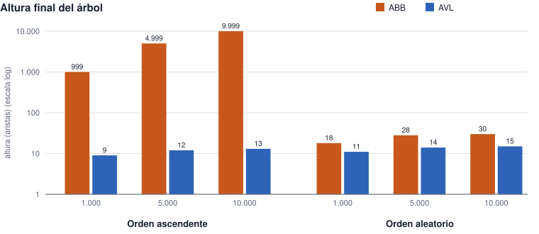
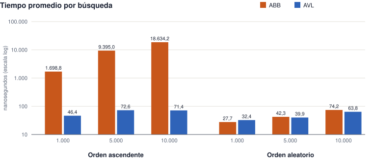

# RedSens · Informe de rendimiento — M2 (ABB vs AVL)

Grupo 3 · Integrante 5 (Tobi) · Semilla 3026 · Java 21.0.13.0.2 · Mac OS X aarch64

## 1. Objetivo

El enunciado plantea que las estaciones llegan del censo ya ordenadas por número. El experimento obligatorio del M2 pide insertar 1.000, 5.000 y 10.000 estaciones en orden ascendente en el ABB y en el AVL, comparar la altura obtenida y el tiempo de búsqueda, repetir con orden aleatorio y explicar los resultados con lo visto en las lecturas.

## 2. Metodología

- **Entorno:** Java 21.0.13.0.2 · Mac OS X aarch64. Clase `redsens.indice.ExperimentoArboles`, sin librerías externas.
- **Semilla:** 3026, la asignada al grupo 3 en la sección 3 del enunciado (`java.util.Random`).
- **Datos:** números de estación únicos entre 0 y 9999 (el formato CBA-NNNN admite exactamente 10.000). Con 1.000 y 5.000 se elige un subconjunto con la semilla; con 10.000 se usan todos. Cada estación es un objeto `Estacion` válido del modelo del equipo.
- **Comparación justa:** en cada escenario se insertan exactamente las mismas estaciones, en el mismo orden, en los dos árboles.
- **Construcción y búsqueda se miden por separado** con `System.nanoTime()`. La generación de datos y las impresiones quedan fuera de toda medición.
- **Búsqueda:** se buscan todas las claves insertadas, en un orden aleatorio fijo e igual para los dos árboles. Se hacen 3 rondas de calentamiento (JIT) y 10 rondas medidas, alternando qué árbol va primero. Se informa el promedio por búsqueda.
- **Verificación previa a medir:** ambos árboles tienen las n estaciones, su inorden coincide con la lista ordenada esperada, cada búsqueda devuelve exactamente el objeto esperado y las claves ausentes devuelven `null`. Los 6 escenarios pasaron (6 de 6).
- **Pila:** con la pila por defecto de la JVM, el ABB de 10.000 claves ascendentes no desbordó (altura 9999). Por seguridad el experimento corre en un hilo con pila de 512 MB, sin modificar el ABB recursivo.
- **Altura:** contada en aristas en ambos árboles (árbol vacío = −1, una hoja = 0).

## 3. Resultados

Valores medidos en la corrida guardada en `resultados/experimento-m2.txt`.

| Estaciones | Orden | Altura ABB | Altura AVL | Búsqueda prom. ABB (ns) | Búsqueda prom. AVL (ns) |
|---|---|---:|---:|---:|---:|
| 1.000 | ascendente | 999 | 9 | 1.698,8 | 46,4 |
| 1.000 | aleatorio | 18 | 11 | 27,7 | 32,4 |
| 5.000 | ascendente | 4.999 | 12 | 9.395,0 | 72,6 |
| 5.000 | aleatorio | 28 | 14 | 42,3 | 39,9 |
| 10.000 | ascendente | 9.999 | 13 | 18.634,2 | 71,4 |
| 10.000 | aleatorio | 30 | 15 | 74,2 | 63,8 |





**Datos complementarios.** Tiempo total de buscar todas las claves (promedio de las rondas medidas), tiempo de construcción (una inserción completa) y cuántas veces más lenta es la búsqueda del ABB:

| Estaciones | Orden | Búsq. total ABB (ms) | Búsq. total AVL (ms) | Construcción ABB (ms) | Construcción AVL (ms) | ABB / AVL (búsqueda) |
|---|---|---:|---:|---:|---:|---:|
| 1.000 | ascendente | 1,699 | 0,046 | 2,050 | 0,582 | 36,61× |
| 1.000 | aleatorio | 0,028 | 0,032 | 0,197 | 0,180 | 0,85× |
| 5.000 | ascendente | 46,975 | 0,363 | 69,121 | 0,308 | 129,41× |
| 5.000 | aleatorio | 0,212 | 0,200 | 0,429 | 0,574 | 1,06× |
| 10.000 | ascendente | 186,342 | 0,714 | 210,694 | 0,414 | 260,98× |
| 10.000 | aleatorio | 0,742 | 0,638 | 0,826 | 0,954 | 1,16× |

## 4. Análisis

**Orden ascendente: el ABB degenera.** Cada número nuevo es mayor que todos los anteriores, así que siempre se cuelga a la derecha del último nodo y el árbol se vuelve una lista: la altura es exactamente n − 1 (999, 4.999 y 9.999). Buscar pasa a costar O(n): una búsqueda recorre en promedio la mitad de la cadena. Se ve en el tiempo, que crece casi en proporción a n: de 1.698,8 ns a 18.634,2 ns (11,0× al multiplicar n por 10). Construirlo cuesta O(n²) en total: de 2,050 ms a 210,694 ms (103×, cerca del 100× que predice n²).

**Orden ascendente: el AVL se mantiene equilibrado.** Después de cada inserción recalcula el factor de equilibrio y aplica rotaciones, así que la altura queda en O(log n). Con 10.000 estaciones busca **261 veces más rápido** que el ABB (71,4 ns contra 18.634,2 ns).

**Orden aleatorio: los dos quedan bajos.** Sin un orden que lo desbalancee, el ABB queda con altura O(log n) en promedio, aunque sin garantía. Es algo más alto que el AVL, pero los tiempos de búsqueda son del mismo orden: con 10.000 estaciones, 74,2 ns el ABB y 63,8 ns el AVL. Con 1.000 estaciones el ABB llega a ser un poco más rápido, porque no paga el costo de guardar alturas ni de rebalancear. Esas diferencias son de pocos nanosegundos y quedan dentro del ruido de medición.

**Comparación con la teoría.** La altura de un AVL nunca supera ≈ 1,44·log₂ n. Las alturas medidas quedan cerca de log₂ n, por debajo de esa cota, con los dos órdenes:

| Estaciones | log₂ n | Cota AVL ≈ 1,44·log₂ n | AVL asc. | AVL aleat. | ABB aleat. | ABB asc. (n − 1) |
|---|---|---:|---:|---:|---:|---:|
| 1.000 | 10,0 | 14,4 | 9 | 11 | 18 | 999 |
| 5.000 | 12,3 | 17,7 | 12 | 14 | 28 | 4.999 |
| 10.000 | 13,3 | 19,1 | 13 | 15 | 30 | 9.999 |

## 5. Conclusiones

- El rendimiento de un ABB depende del orden de llegada de los datos. Con datos ya ordenados degenera en una lista y sus operaciones pasan de O(log n) a O(n).
- El AVL garantiza O(log n) en cualquier orden, a cambio de un pequeño costo extra por rotaciones y alturas.
- Como en RedSens las estaciones llegan del censo ordenadas por número, el índice del sistema debe ser el AVL. Es también el que el enunciado prevé para «Cargar la red» desde el menú.

## 6. Cómo reproducirlo

Desde la raíz del proyecto, con Java 21:

```bash
javac -encoding UTF-8 -d out $(find src -name "*.java")
java -cp out redsens.indice.ExperimentoArboles 3026
```

Las alturas son deterministas: con la misma semilla dan siempre lo mismo. Los tiempos dependen de la máquina; en re-ejecuciones sobre el mismo equipo variaron hasta un 15 % en los casos de pocos nanosegundos, sin cambiar las conclusiones.

Limitaciones: mediciones en una sola máquina; los tiempos menores a ~100 ns son sensibles al JIT y al sistema operativo. Este informe cubre el M2; se integra al informe general de rendimiento junto con M1 y M5.
